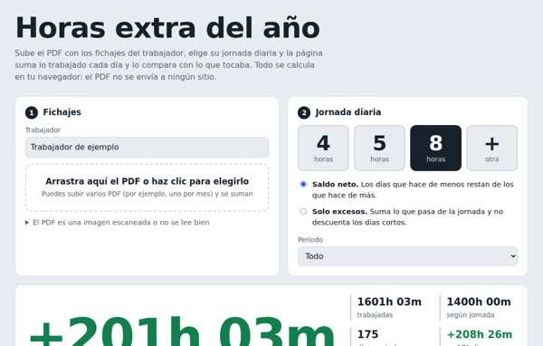
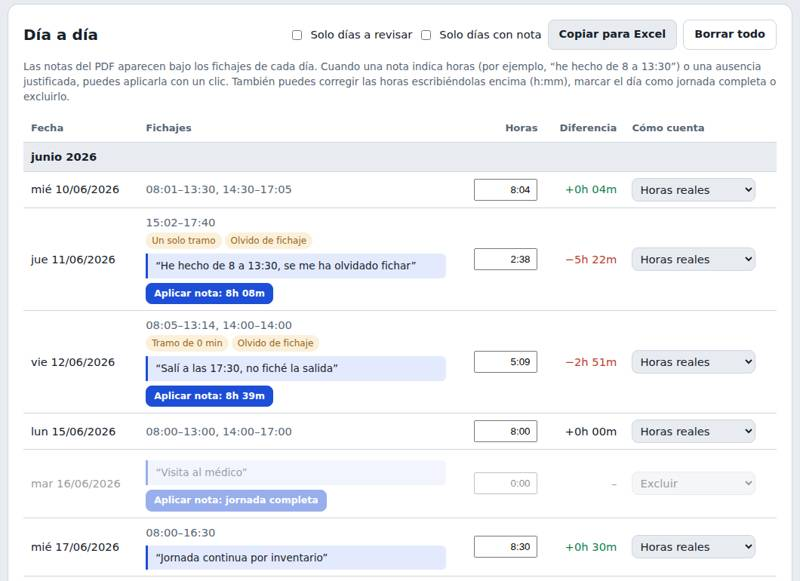

# Horas extra del año

Calculadora web de horas extra a partir del PDF de fichajes de un trabajador.

**Abrir:** https://ossama450298-commits.github.io/horas-extra/

## Cómo se usa
1. Sube uno o varios PDF de fichajes (o pega el texto si el PDF es un escaneo).
2. Elige la jornada diaria: 4 h, 5 h, 8 h u otra.
3. Elige el criterio: saldo neto (los días cortos restan) o solo excesos.

Muestra el total de horas extra, el resumen por mes con gráfico y el detalle día a día. Marca los fichajes a revisar (sin salida, tramos de 0 min, un solo tramo) y permite corregir horas, contar un día como jornada completa o excluirlo. El botón «Copiar para Excel» copia la tabla.

### Notas del PDF
Lee las notas escritas en los fichajes y las muestra en cada día. Si una nota indica horas («he hecho de 8 a 13:30», «salí a las 17:30») calcula las horas reales del día sin duplicar tramos ya fichados; si indica una ausencia justificada (médico, vacaciones, permiso, formación) propone contar jornada completa. Las sugerencias se aplican día a día o todas de golpe, y el total muestra cuánto cambiaría.

El PDF se procesa en el navegador; no se envía a ningún servidor.
